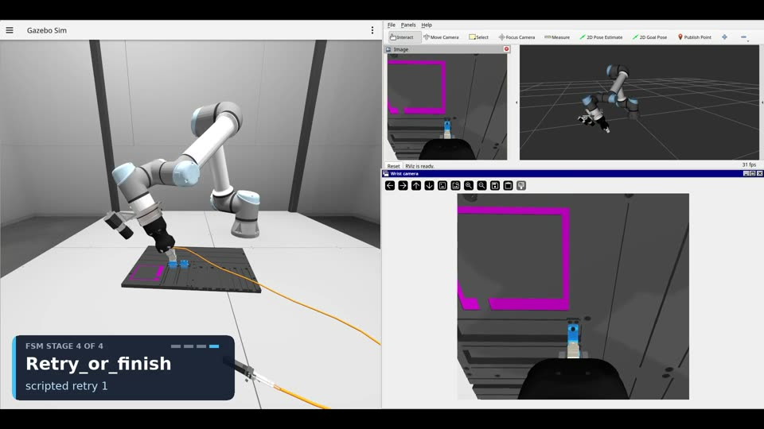
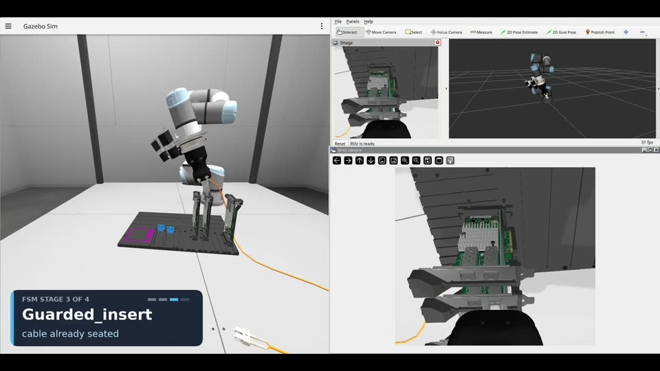
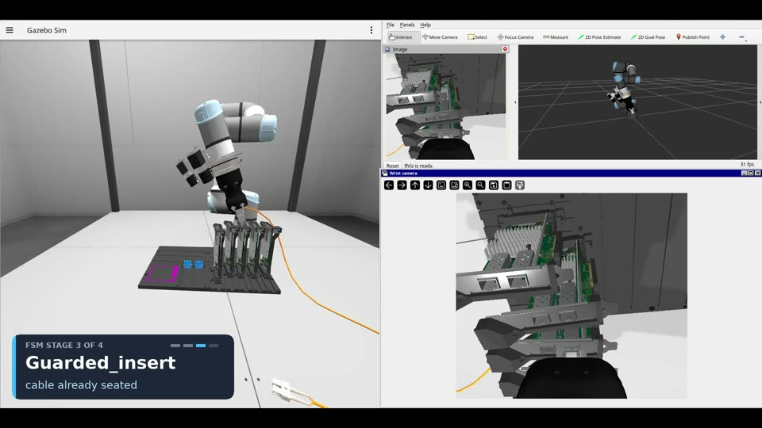
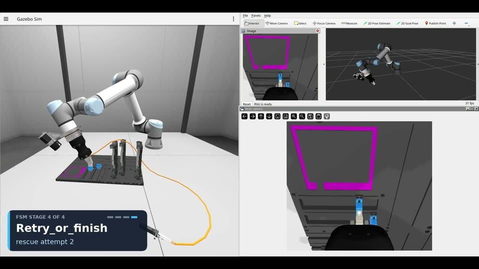
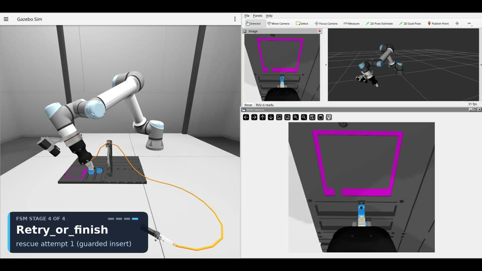
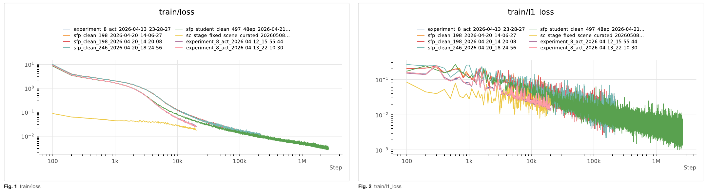
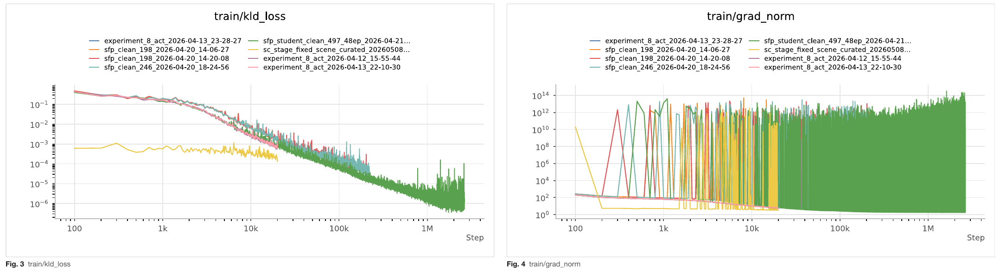
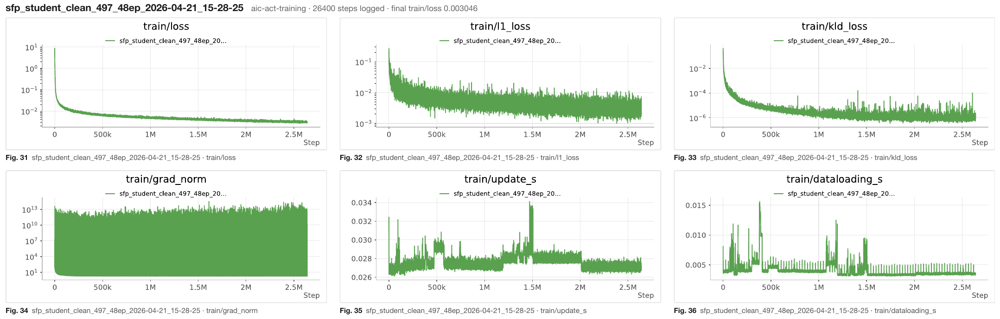

# Quantarune: Project Automaton

Welcome to our submission for intrinsic's AI for Industry Challenge!! 

From February 2026 to June 2026, I competed in Intrinsic’s AI for Industry Challenge, finishing it with Rucha Agashe as Team Quantarune. At the time, I wanted to pivot from building with agentic systems and post-training language models to Physical AI, because I believed robotics is the future. This was my first proper robotics project. I was most interested in reinforcement learning and simulations, and hoped that the competition would allow me to apply RL for once. I even bought an RTX 5090 workstation for it.

Intrinsic’s AI for Industry Challenge is a competition run by Alphabet’s Intrinsic with NVIDIA and Foxconn. Teams are asked to create a robot policy that gets a Universal Robots UR5e robotic arm to insert a fiber-optic cable into a server port across two connector types (SC & SFP), inside Gazebo.

> To see a more detailed write-up, visit my website: [sienarindustries.com/project/project-automaton](https://sienarindustries.com/project/project-automaton).

> We finished 49th out of 196 teams. Our policy scored 141 in our local benchmark and 89 on the competition held-out evals.

## Repository structure

```
quantarune/
  data-collection/   recorder, scripted data runs, teleop and replay
  perception/        classical CV, segmentation model, SAM + DINOv2, MegaPose
  policies/          the ACT-FSM policy and its variants
  training/          ACT training pipeline and an unused flow-matching stack
docs/                W&B report and charts, policy iterations, videos
submodules/aic/      the organisers' challenge code (intrinsic-dev/aic)
```

Each folder under `quantarune/` has its own README.

## Videos

<table>
  <tr>
    <td width="50%"><a href="https://www.youtube.com/watch?v=uIU_bVWS30E&t=3s"></a></td>
    <td width="50%"><a href="https://www.youtube.com/watch?v=havYEkYhJIg"></a></td>
  </tr>
  <tr>
    <td align="center"><b>Our Final Policy, an ACT-FSM doing cable-insertion</b><br><a href="https://www.youtube.com/watch?v=uIU_bVWS30E&t=3s">link</a> (from 0:03)</td>
    <td align="center"><b>Initial versions of our trained ACT model's poor performance in doing cable insertion</b><br><a href="https://www.youtube.com/watch?v=havYEkYhJIg">link</a></td>
  </tr>
</table>

<table>
  <tr>
    <td width="50%"><a href="docs/videos/%5Bsc%20easy%20full%20insertion%204%5D%20RunACTStaged%20%2B%20scripted%20insert%20v3%20retry%20%5BSC%20004%2C%20gt-off%5D%2020261027_121042_edited_voice.mp4"></a></td>
    <td width="50%"><a href="docs/videos/sfp_align_guarded_gentle_90point4_20260511_001_002_edited_voice.mp4"></a></td>
  </tr>
  <tr>
    <td align="center">Learned ACT stages plus the scripted finish on SC scene 004, ground truth off. Seats on the second attempt, score 96.86.<br><a href="docs/videos/%5Bsc%20easy%20full%20insertion%204%5D%20RunACTStaged%20%2B%20scripted%20insert%20v3%20retry%20%5BSC%20004%2C%20gt-off%5D%2020261027_121042_edited_voice.mp4">link</a></td>
    <td align="center">CheatCode teacher on an SFP three-card board, ground truth on. Clean insertion, score 90.41.<br><a href="docs/videos/sfp_align_guarded_gentle_90point4_20260511_001_002_edited_voice.mp4">link</a></td>
  </tr>
  <tr>
    <td width="50%"><a href="docs/videos/sfp_terminal_gentle_collect_90point3_20260512_001_023_edited_voice.mp4"></a></td>
    <td width="50%"><a href="docs/videos/sc_guarded_heavy_autorescue_82point3_20260510_003_015_edited_voice.mp4"></a></td>
  </tr>
  <tr>
    <td align="center">CheatCode teacher on an SFP five-card board, ground truth on. Clean insertion, score 90.59.<br><a href="docs/videos/sfp_terminal_gentle_collect_90point3_20260512_001_023_edited_voice.mp4">link</a></td>
    <td align="center">CheatCode auto-rescue on an SC three-card board with a deliberately wrong target. Three rescues, score 82.35.<br><a href="docs/videos/sc_guarded_heavy_autorescue_82point3_20260510_003_015_edited_voice.mp4">link</a></td>
  </tr>
  <tr>
    <td width="50%"><a href="docs/videos/sc_retry_reseat_autorescue_84point8_20260509_001_010_edited_voice.mp4"></a></td>
  </tr>
  <tr>
    <td align="center">CheatCode auto-rescue on an SC one-card board with a larger wrong target. Two rescues, score 84.84.<br><a href="docs/videos/sc_retry_reseat_autorescue_84point8_20260509_001_010_edited_voice.mp4">link</a></td>
  </tr>
</table>

## Approach

> For more details of our various iterations before we settled on our final submission, see [policy-iterations.md](docs/policy-iterations.md).
> For a seamless end-to-end story, I insist you read the writeup in my website:
> [sienarindustries.com/project/project-automaton](https://sienarindustries.com/project/project-automaton).

We replaced the single end-to-end ACT policy with a four-state machine ([`RunACTStaged.py`](quantarune/policies/act-fsm/RunACTStaged.py)), so each constrained state could use whatever worked:

- **APPROACH**: ACT drives the TCP from the dock towards the port. Advances to the next state once the model’s target has settled to within 25 mm.
- **ALIGN**: still ACT, but damped. Instead of naively moving the TCP straight to each new target the ACT model produces, the arm moves only a quarter of the way towards it per step, so a noisy prediction can’t throw the tip off. The stage ends when lateral XY-error is \<15mm and angular error \<0.12 rad, and both errors hold for \>0.75 seconds. At this point, the policy reads the direction the ACT model has been pushing in and locks it as the insert axis. 
- **GUARDED_INSERT**: ACT is switched off. The arm steps along the fixed axis about 5mm per quarter-second, decelerating if the force-torque sensor climbs from 12N to 19N. A supervisor also clamps every step (\<1mm of lateral drift, and \<0.01 radian of rotation) and aborts on four triggers:
  - Force-torque sensor >18N
  - 1.5 seconds with no progress (indicating TCP getting stuck on port)
  - 6 stalled GUARDED_INSERT attempts
  - Lateral oscillations
- **RETRY_OR_FINISH**: if TCP was aborted during GUARDED_INSERT, we return to ALIGN to try once more, else task success.

The ACT models behind APPROACH and ALIGN were trained on our custom-curated recorded trajectories. We made CheatCode (the scripted reference policy from Intrinsic) run under perturbations, and used our teleoperated insertions, so the model had seen clean approaches, near-misses and recoveries rather than only best case scenarios. The insertion portion of our policy (GUARDED_INSERT) had no learned components, it relies only on analytically controlled force-scaled stepping. This consequently was our only policy which reliably made contact without slamming into the ports.

Our best ground-truth-off scores in the table below come from a variant, [`RunACTStagedScriptedInsert`](quantarune/policies/scripted-insert/), which keeps APPROACH and ALIGN and replaces GUARDED_INSERT with a scripted wiggle-and-retry insertion.


## Results 

### Weights & Biases: training loss curves

> The Weights & Biases training report for the ACT policies (finished runs) is at
> [docs/aic-act-training-wandb-report.pdf](docs/aic-act-training-wandb-report.pdf).
> The charts below are our logged training results from Weights & Biases:

<p align="center"></p>
<p align="center"></p>
<p align="center"></p>

### Our results on Intrinsic's AIC Evaluation Engine

> NOTE: it is very difficult and infeasible to include every obtained result in this table, so we decided to include results which showcase the most variety across scenarios and scores too.

| Scenario | Method | Max score | Notes |
|---|---|---|---|
| SC scene 004, no cards, ground truth off | learned stages + scripted finish | 98.00 | 35 full insertions over the stitch batches, 7 of 10 on the v4 and v5 batches |
| SC scene 004, ground truth off | learned stages + scripted finish, one retry | 96.86 | the opening clip |
| SC scene 004, ground truth off | learned stages + scripted finish, FSM retry twice then finish | 53.73 | the retry clip, ends a centimetre short |
| SC scene 005, two cards, ground truth off | learned stages + scripted finish | 40.62 | lands about 2 cm beside the socket, no insertion |
| SC scene 026, four cards, ground truth off | visual-servo replay | 91.57 | one full insertion, eight partials at 53 to 54 |
| SFP scene 137, four cards, ground truth off | learned stages | 37.8 to 42.4 | four attempts, all about 5 cm off |
| SFP three-card and five-card boards, ground truth off | ACT FSM | 90.41 and 90.59 | reference runs, not our policy |
| SC carded boards, ground truth on | ACT FSM | 82.35 and 84.84 | reference runs showing back-out and re-centre |
| SFP scene 137, ground truth off, after the challenge | taught templates + image servo + scripted insert | 87.21, 87.20, 87.15 | three of three inserted, see MegaPose below |

In the qualification round our final submission finished 49th of 196 teams.

## How to run

The policies run inside the organisers' (Intrinsic, NVIDIA) evaluation stack, which is the
Gazebo and ROS 2 setup of `aic/IntrinsicAIChallenge/` with the
`aic_model` policy interface. The steps below name the scripts; the paths
inside them still point at the original repository layout and its pixi
environment, so expect to adjust them.

1. Set up the organisers' stack from `aic/IntrinsicAIChallenge/` and apply
   our edits from `quantarune/isaac-training/patches/`, which hold every
   file we changed in the organiser packages at its relative path.
2. Record demonstrations with the CheatCode teacher through
   `quantarune/act-fsm/pipeline/.../run_engine_case_cheatcode.sh`. The
   engine launcher copies a controller config with a 30 N wrench cap into
   the container; restore the organiser default of 10 N afterwards.
3. Build the stage datasets with `build_sc_stage_datasets.sh`, which calls
   `build_sc_stage_act_datasets.py`, or download them from Hugging Face.
4. Train the four heads with `train_sc_stage_teachers.sh`, which calls
   `train_act_dataset.sh` and `lerobot_train_patched.py`.
5. Run a trial with `RunACTStagedScriptedInsert.py` as the `aic_model`
   policy. The stage heads are selected with the environment variables
   `AIC_ACT_STAGE_ROUTE_APPROACH`, `_ALIGN`, `_GUARDED_INSERT` and
   `_RETRY_OR_FINISH`, and the scored bag and its scoring file land in the
   engine's results folder.

## Datasets and models on Hugging Face

| Hugging Face repo | Type | Contents |
|---|---|---|
| [quantarune-act-fsm-sc-demonstrations](https://huggingface.co/datasets/shng2025/quantarune-act-fsm-sc-demonstrations) | dataset | SC teacher demonstrations |
| [quantarune-act-fsm-sfp-demonstrations](https://huggingface.co/datasets/shng2025/quantarune-act-fsm-sfp-demonstrations) | dataset | SFP teacher demonstrations |
| [quantarune-act-fsm-sc-stage-dataset](https://huggingface.co/datasets/shng2025/quantarune-act-fsm-sc-stage-dataset) | dataset | SC LeRobot dataset cut into the four stages |
| [quantarune-act-fsm-sfp-stage-dataset](https://huggingface.co/datasets/shng2025/quantarune-act-fsm-sfp-stage-dataset) | dataset | SFP LeRobot dataset cut into the four stages |
| [quantarune-act-fsm-scored-trials](https://huggingface.co/datasets/shng2025/quantarune-act-fsm-scored-trials) | dataset | scored trial bags with their scoring files |
| [quantarune-act-fsm-sc-scripted-insert](https://huggingface.co/shng2025/quantarune-act-fsm-sc-scripted-insert) | model | scripted insert model |

## Acknowledgements

The scoring engine, running and simulation of the AI for Industry Challenge is done by Intrinsic, NVIDIA and Foxconn, as well as all related assets (thanks!). 
Action Chunking Transformer usage came from the original authors of
ACT (Zhao et al., 2023) 

Also to thank are the authors of Segment Anything, DINOv2, CNOS,
MegaPose and InsertionNet, whose work the perception experiments follow.

## Credits

- Initially, I worked with Natalia Chan and Evan O’Leary in Team Servos.
- Then, I worked with Evan O’Leary, Ali Muhammad, Justin, Enrique, Tommy and Sanjay in Team Rangers.
- Ultimately, I worked with Rucha Agashe in Team Quantarune. This repo is the work that we (Shi Hao and Rucha) did and found the most successful out of all approaches. 
- It is a huge pleasure to work with all of you for which I’ve learned a lot. 

## Licence

MIT, see [LICENSE](LICENSE).
